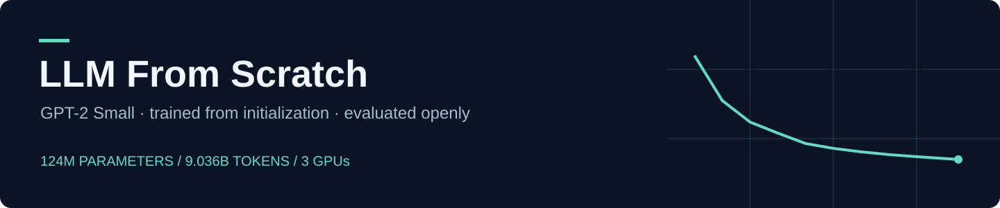
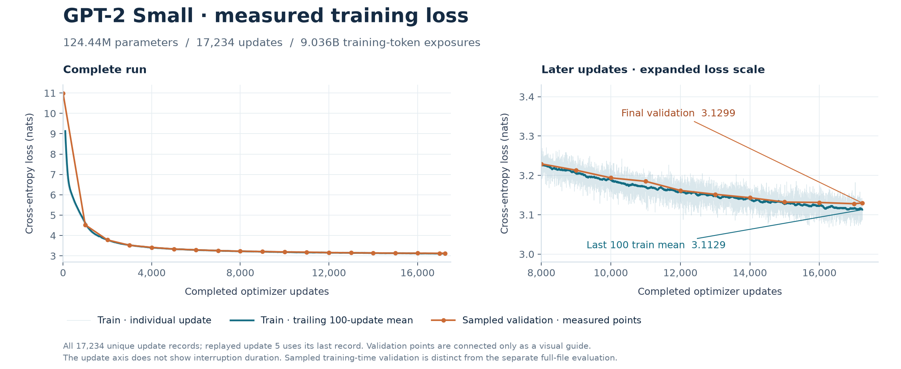
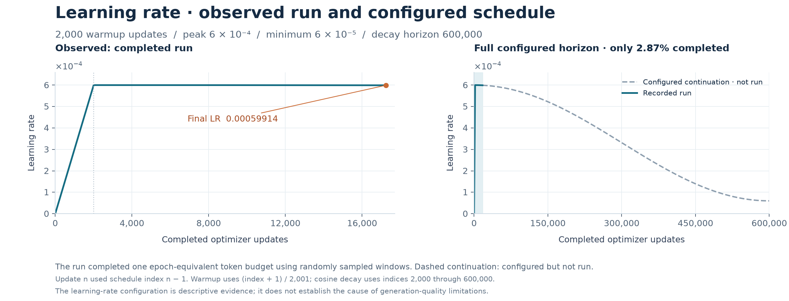

<p align="center">
  
</p>

# LLM From Scratch

**A GPT-2 Small model trained from random initialization on OpenWebText, with reproducible code, complete training curves, and measured evaluations.**

The completed model has **124,439,808 parameters** and was trained for **17,234 optimizer updates**, processing **9.036 billion tokens** across three GPUs on three machines. This repository follows the project from individual Transformer components to distributed pretraining and evaluation against the released GPT-2 Small checkpoint.

[Training guide](docs/training.md) · [Evaluation and benchmarks](docs/evaluation.md) · [Model card](docs/model-card.md) · [Architecture](docs/architecture.md) · [Results data](results/) · [Learning exercises](learning/README.md)

## Measured results

| Training result | Value |
| :--- | ---: |
| Completed updates | 17,234 |
| Training-token exposures | 9,035,579,392 |
| Final training cross-entropy | 3.1068 |
| Final sampled validation cross-entropy | 3.1299 |
| Final sampled validation perplexity | 22.8709 |
| Separate full-file validation perplexity | 21.2342 |
| Aggregate training-update throughput | 42,652 tokens/s |

Cross-entropy uses natural logarithms. Throughput combines all three workers and excludes downtime and work outside timed updates. The full-file evaluation uses different context and coverage rules from sampled training validation; the two perplexities are **different protocols**, not an improvement between checkpoints.

### Training loss



Every optimizer update is represented in the [training metrics CSV](results/training_metrics.csv). The [training guide](docs/training.md) explains validation sampling, duplicate-log handling, and how to regenerate the figures.

### Zero-shot benchmarks

Full validation/test splits were scored with **LM Evaluation Harness 0.4.13**, using the same task definitions, tokenizer, precision policy, and examples for both models.

| Task | Examples | This model — accuracy | Released GPT-2 Small — accuracy |
| :--- | ---: | ---: | ---: |
| LAMBADA (OpenAI) | 5,153 | **29.25%** | 32.56% |
| HellaSwag | 10,042 | **27.72%** | 28.92% |
| PIQA | 1,838 | **60.94%** | 62.89% |
| ARC-Easy | 2,376 | **42.13%** | 43.81% |

The table uses **raw accuracy**; character-length-normalized multiple-choice scores and paired uncertainty estimates are in the [evaluation report](docs/evaluation.md). The released reference has a different training history, so this is a checkpoint comparison, not an equal-compute experiment.

The model produces readable continuations, but sustained coherence and factual consistency remain limited. Evaluation covered **600 generated continuations across both models**. Greedy decoding showed repetition; sampled indented-code prompts also exposed whitespace failures. See the [model card](docs/model-card.md) for these limits. This is a pretrained completion model, not an instruction-tuned chat assistant.

## Repository structure

```text
.
├── gpt2/                    # Completed 124M experiment; original verified source
│   ├── train.py             # Architecture, optimizer, DDP, checkpoints, recovery
│   ├── prepare.py           # Pinned OpenWebText preparation and verification
│   └── inference.py         # CPU completion from a trusted local checkpoint
├── evaluation/              # Portable evaluation code and pinned task protocol
├── configs/                 # Sanitized record of the completed experiment
├── results/                 # Compact measured metrics and provenance
├── scripts/                 # Rebuild publication figures and check repository
├── docs/                    # Training guide, evaluation, model card, figures
├── llm/                     # Historical 163M model components
├── training/                # Historical 163M training pipeline
├── learning/                # Tokenization, attention, embeddings, SFT exercises
└── .github/workflows/       # CPU smoke and repository checks
```

The `gpt2/` training, preparation, and inference files are byte-identical copies of the source used locally; their [SHA-256 hashes](results/source_provenance.json) make that provenance explicit. Earlier `llm/`, `training/`, and learning examples are retained with their original imports. They are separate experiments and did not produce the results above.

## Quick start

Use Linux and Python 3.11 or newer; the completed run was tested on Python 3.13.11. Install a PyTorch build for your hardware, then the pinned core dependencies:

```bash
git clone https://github.com/Vansh-A1/LLM_FROM_SCRATCH.git
cd LLM_FROM_SCRATCH
python -m venv .venv
source .venv/bin/activate
python -m pip install -r requirements.txt
python gpt2/train.py --smoke-test --device cpu
```

The smoke test uses synthetic tiny models and temporary checkpoint round trips. It does not download OpenWebText or start a real training run. For the CUDA 12.8 stack used in the completed run, preparation, three-machine launch, and resume commands, follow the [training guide](docs/training.md).

### Generate a continuation

Supply your own trusted checkpoint in this project's checkpoint format:

```bash
python gpt2/inference.py \
  --checkpoint /path/to/final.pt \
  --prompt "The future of artificial intelligence is" \
  --max-new-tokens 128 --temperature 0.8 --top-k 40 --seed 42
```

This entry point runs on CPU. Training checkpoints include optimizer and RNG state and use Python pickle; only load checkpoints you trust. The repository contains **source and compact results, not model weights or the corpus**. The evaluated checkpoint's hash is published in the [experiment record](configs/gpt2-small-epoch1.json); downloading this repository alone does not supply pretrained weights.

## Training schedule

The run stopped after **one epoch-equivalent token budget at 17,234 updates**. Its unchanged learning-rate schedule was configured for **600,000 updates**, with **2,000 warmup updates**, peak LR **6e-4**, and minimum LR **6e-5**. It therefore finished near the peak LR, before most of cosine decay. All reproduction commands explicitly use `--stop-at 17234`.



The [experiment record](configs/gpt2-small-epoch1.json) captures architecture, optimizer, runtime, dataset hashes, hardware, and checkpoint identity. It is an archival record, not a configuration file consumed by the trainer.

## Development and attribution

Run `python scripts/check_repository.py` for source syntax, local documentation links, artifact-size checks, and recorded source hashes. Run the CPU smoke test before changing core training logic. Contributions should include reproducible evidence; see [CONTRIBUTING.md](CONTRIBUTING.md).

The GPT-2 implementation and preparation code adapt [Andrej Karpathy's nanoGPT](https://github.com/karpathy/nanoGPT) and draw on [build-nanogpt](https://github.com/karpathy/build-nanogpt). Evaluation uses [EleutherAI's LM Evaluation Harness](https://github.com/EleutherAI/lm-evaluation-harness) and the [released GPT-2 Small checkpoint](https://huggingface.co/openai-community/gpt2). Existing third-party license notices are preserved; see [THIRD_PARTY_NOTICES.md](THIRD_PARTY_NOTICES.md). A project-wide license has not yet been declared.

Built by [Vansh Joshi](https://github.com/Vansh-A1).
