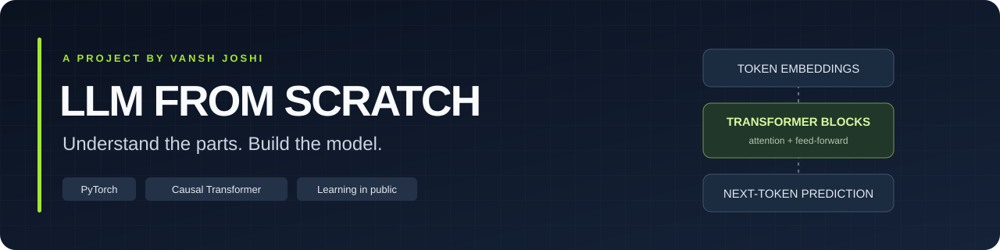
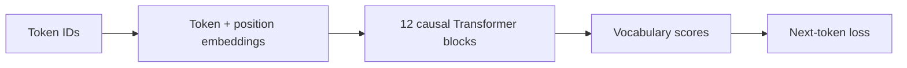

<p align="center">
  
</p>

<p align="center">
  <a href="https://www.python.org/"></a>
  <a href="https://pytorch.org/"></a>
  
  
</p>

# LLM From Scratch

A language-model project built to understand each component: tokenization,
embeddings, causal attention, Transformer blocks, and next-token training.
The code stays explicit so the math and the training loop can be followed by hand.

**Start with [`llm/`](llm/) for the model and [`training/`](training/) for the current
training run.** Earlier exercises live separately in [`learning/`](learning/).

[Model components](llm/) · [Training guide](docs/training.md) · [Learning exercises](learning/README.md) · [Contributing](CONTRIBUTING.md)

## Repository map

```text
LLM_FROM_SCRATCH/
├── llm/                         # Active model components
│   ├── attention.py             # Causal multi-head self-attention
│   ├── transformer_block.py     # Attention, feed-forward layers, residuals
│   └── model.py                 # Transformer stack and vocabulary projection
├── training/                    # Active input and training code
│   ├── dataset.py               # Streaming token windows and DataLoader
│   └── train.py                 # Training, validation, checkpoints, plots
├── learning/                    # Earlier exercises, grouped by concept
│   ├── tokenization/
│   ├── data_loading/
│   ├── embeddings/
│   └── attention/
├── docs/
│   ├── training.md              # Local inputs, run settings, output files
│   └── assets/banner.svg
├── CONTRIBUTING.md
└── requirements.txt
```

Dataset files, downloaded books, acquisition scripts, cleaning utilities, model
weights, and generated run output are outside the published code tree. The trainer
accepts an already prepared local corpus; see the [input format](docs/training.md#local-input-files).

## The active model



| Component | Configuration |
| --- | --- |
| Architecture | Decoder-only, pre-normalization Transformer |
| Transformer blocks | 12 |
| Hidden width / attention heads | 768 / 12 |
| Context length | 1,024 tokens |
| Vocabulary | GPT-2 tokenizer, 50,257 tokens |
| Position embeddings | Learned |
| Feed-forward layers | Width 3,072 with GELU |
| Dropout | 0.1 |
| Complete model | **163,037,184 parameters** |

Input token embeddings and the vocabulary output projection use separate weights.
The embeddings are defined in the training script and trained alongside the model.

## Get started

Install a PyTorch build appropriate for your hardware, then install the remaining
requirements in a virtual environment:

```bash
git clone https://github.com/Vansh-A1/LLM_FROM_SCRATCH.git
cd LLM_FROM_SCRATCH
python -m venv .venv
source .venv/bin/activate
python -m pip install -r requirements.txt
```

On Windows, use `.venv\Scripts\activate` to activate the environment.

Place your prepared corpus outside the repository or in the ignored `data/`
directory. The corpus directory needs `train.txt`, `train.documents.jsonl`,
`validation.txt`, and `validation.documents.jsonl`.

```bash
export LLM_DATA_DIR="/absolute/path/to/prepared/corpus"
export LLM_OUTPUT_DIR="/absolute/path/to/training/run"
python -m training.train
```

The [training guide](docs/training.md) documents input offsets, resuming, and the
complete output layout. Settings remain near the top of `training/train.py`.

## Current experiment

| Setting | Default |
| --- | --- |
| Training subset | 300 million target tokens per epoch, rounded to complete windows |
| Epochs | 3 |
| Micro-batch / gradient accumulation | 4 / 4 |
| Optimizer | AdamW, learning rate 0.0003 |
| Warmup / gradient clipping | 20 updates / maximum gradient norm 1.0 |
| Mixed precision | BF16 on supported CUDA GPUs |
| Validation | Every 10 optimizer updates and at each epoch end |
| Validation sample | The same first 10 held-out batches, about 40,960 target tokens |
| Loss graph and CSV | Refreshed after each validation check |
| Checkpoints | One snapshot per epoch, plus `last.pt` for resuming |

The token cap is applied **before shuffling**. Each epoch uses the same subset,
with a different deterministic shuffle. At the default settings, complete windows
provide **299,999,232 target tokens** and **18,311 optimizer updates per epoch**.

The validation curve is a fixed-sample metric. It is useful for tracking the run,
but it is not a score over the entire held-out corpus. Training results and model
capabilities will be documented when evaluated; the parameter count alone is not
a performance claim.

## Learn one component at a time

The [`learning/`](learning/README.md) directory keeps the original progression:
a regex tokenizer, GPT-2 encoding, input/target windows, token embeddings, and
single-head attention. Historical drafts are labeled separately and are not
imported by the active trainer.

Built and maintained by [Vansh Joshi](https://github.com/Vansh-A1).
