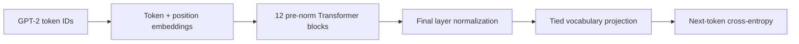

# Architecture and code map

The completed GPT-2 Small model is a decoder-only, pre-normalization Transformer with **124,439,808 unique trainable parameters**. It uses 12 layers, width 768, 12 attention heads, a 3,072-wide MLP, learned positions, a 1,024-token context, and a 50,257-token GPT-2 vocabulary. Embedding and output-projection weights are tied. Biases are enabled, dropout is zero, and GELU uses the tanh approximation.

Each block contains causal multi-head attention followed by a feed-forward network, with residual additions around both. Causality prevents attention to future positions. The loss is computed against tokens shifted by one position.

## Source entry points

| File / symbol | Responsibility |
| --- | --- |
| `gpt2/train.py`: `GPTConfig`, `GPT` | Architecture and forward-pass primitives |
| `gpt2/train.py`: `TrainConfig`, `get_lr` | Optimizer settings and warmup/cosine schedule |
| `gpt2/train.py`: batch/accumulation helpers | Exact global token budget across uneven DDP quotas |
| `gpt2/train.py`: smoke tests | Attention causality, loss/batching invariants, and checkpoint round trips |
| `gpt2/train.py`: `main`, recovery routines | Training, validation, atomic checkpointing, distributed lifecycle |
| `gpt2/prepare.py` | Pinned OpenWebText download, tokenization, split, binary/manifest verification |
| `gpt2/inference.py` | Explicit trusted checkpoint loading and CPU sampling |
| `evaluation/` | Frozen-task likelihood scoring and post-training analysis |

The experiment's training implementation remains in a single source file to preserve its verified hash and checkpoint compatibility. Public organization separates data preparation, training, inference, evaluation, evidence, and documentation without changing model semantics.

## Historical code

`llm/` and `training/` implement an earlier approximately 163M-parameter experiment with untied vocabulary matrices. `learning/` contains individual exercises and later exploratory files. These modules are retained for the learning history; they did not produce the 124M results. See [legacy-training.md](legacy-training.md) for that trainer's original commands and assumptions.
