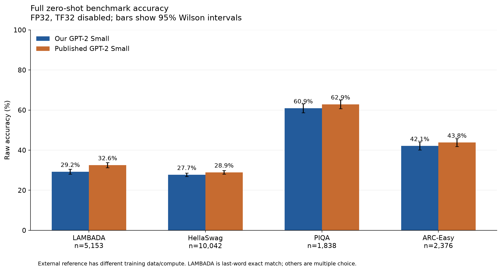
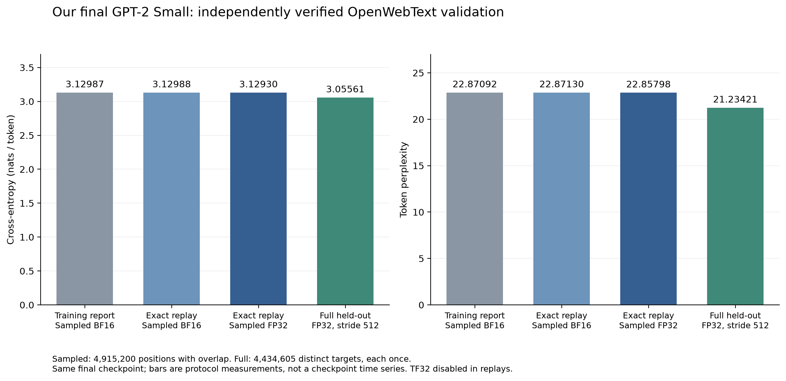
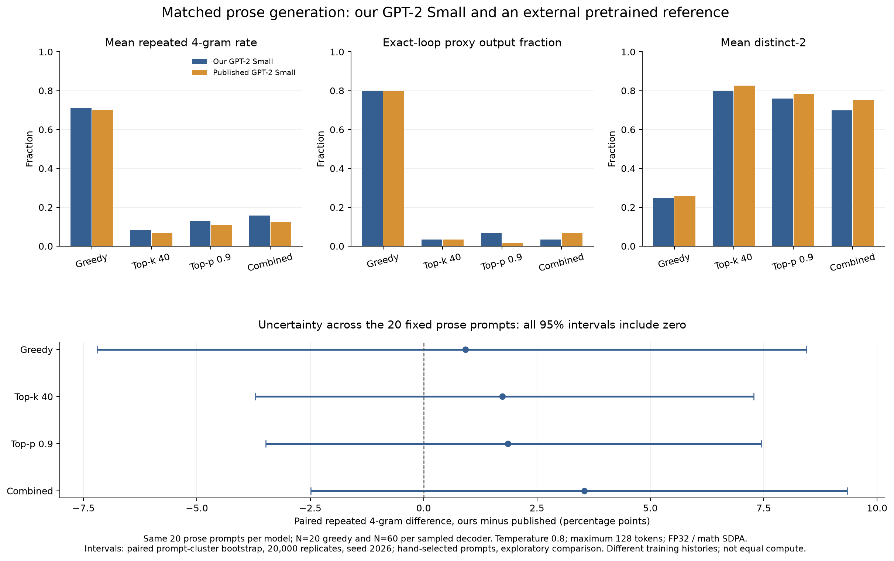

# Evaluation report

The final 124,439,808-parameter checkpoint completed **17,234 optimizer updates** and **9,035,579,392 training-token exposures**. Evaluation was inference-only. Every result below describes that immutable checkpoint; no further training was performed during evaluation.

## Checkpoint and reference

- Primary checkpoint SHA256: `6fe9cc53a9b3890d682c54208a54ce696ed8be98fbff414d1fa19b212aa3b1fe`.
- Model-definition source SHA256: `9e1416e3a2fe393097b05c51575ae434bfea464bbc2d8c82c9ee909115945a40`.
- External reference: [openai-community/gpt2](https://huggingface.co/openai-community/gpt2/tree/607a30d783dfa663caf39e06633721c8d4cfcd7e), revision `607a30d783dfa663caf39e06633721c8d4cfcd7e`.
- Reference safetensors SHA256: `248dfc3911869ec493c76e65bf2fcf7f615828b0254c12b473182f0f81d3a707`.

The reference has different training data and training history. This is a comparison of final models, **not an equal-compute experiment**. The exact earlier 163M checkpoint was unavailable, so these results make no matched improvement claim over that model.

## Full zero-shot benchmarks

[Machine-readable results](../results/benchmarks.json) include exact correct counts, individual Wilson intervals, paired differences and dataset revisions. All four tasks were evaluated in full: **19,409 items and 58,498 candidate likelihood requests per model**. No scored request required context truncation.

| Task | Items | Ours: raw accuracy | Reference: raw accuracy | Ours: normalized | Reference: normalized |
|---|---:|---:|---:|---:|---:|
| LAMBADA | 5,153 | 29.2451% | 32.5636% | — | — |
| HellaSwag | 10,042 | 27.7236% | 28.9185% | 29.3169% | 31.1392% |
| PIQA | 1,838 | 60.9358% | 62.8945% | 60.7182% | 62.5136% |
| ARC-Easy | 2,376 | 42.1296% | 43.8131% | 38.7205% | 39.4781% |

Normalized multiple-choice accuracy uses the original harness's **character-length normalization**, not token-length normalization. LAMBADA is target-last-word greedy exact match. Its target-word perplexity is 62.2959 for our model and 40.0554 for the reference; these are not ordinary full-text token perplexities.

Uniform-choice references are 25% for HellaSwag, 50% for PIQA and 25.0161% for ARC-Easy (the last includes three-, four- and five-choice questions). LAMBADA has no analogous fixed-choice baseline.

### Protocol and uncertainty

The evaluation used [EleutherAI LM Evaluation Harness](https://github.com/EleutherAI/lm-evaluation-harness) **0.4.13**, zero demonstrations, no chat template, and seeds 42. Original task YAML hashes, preprocessing, prompts, continuation boundaries, metrics and aggregation were retained. Primary scoring used FP32 PyTorch SDPA MATH; the external reference used FP32 Transformers eager attention. TF32 and autocast were disabled for both. The same tokenizer and likelihood adapter scored both models.

| Task | Dataset | Revision | Scored split |
|---|---|---|---|
| LAMBADA | EleutherAI/lambada_openai | `900124bf3b8235c6daf21033af9948b3f07346c4` | test |
| HellaSwag | Rowan/hellaswag | `218ec52e09a7e7462a5400043bb9a69a41d06b76` | validation |
| PIQA | baber/piqa | `142f6d7367fd9877f0fb3b5734ea6a545f54cdd1` | validation |
| ARC-Easy | allenai/ai2_arc | `210d026faf9955653af8916fad021475a3f00453` | test |

The historical evaluation loaded SHA256-verified cached Arrow data. The portable runner can use those exact Arrow exports or download the pinned dataset revisions. It records which loading path was used. A fresh dataset-library serialization need not have the historical Arrow file hash, even when its rows match.

The primary run changed maximum inference batch size from 8 to 32 while retaining committed request scores. A 32-request parity check found a maximum absolute likelihood difference of 0.0000305176 and no raw or normalized answer flips. The result therefore has mixed batch-size provenance. Reference inference used maximum batch size 32. ARC-Easy metadata recovery reused all 9,501 already completed CUDA request scores; it did not rescore the model on CPU.

Identical document IDs, documents, prompts and targets were checked before paired comparisons. The 10,000-resample paired bootstrap used seed 42. Raw accuracy differences (ours minus reference) were:

| Task | Difference | Paired 95% interval |
|---|---:|---:|
| LAMBADA | −3.3185 pp | [−4.4440, −2.1929] pp |
| HellaSwag | −1.1950 pp | [−1.6730, −0.7269] pp |
| PIQA | −1.9587 pp | [−3.6453, −0.2720] pp |
| ARC-Easy | −1.6835 pp | [−3.3670, 0.0000] pp |

Intervals are exploratory and unadjusted for multiple comparisons. ARC-Easy's interval touching zero does not establish equivalence. No complete training-corpus versus benchmark decontamination audit was performed.

## Validation loss and perplexity

| Measurement | Cross-entropy | Perplexity | Coverage |
|---|---:|---:|---|
| Final training validation | 3.1298661 | 22.8709 | 4,915,200 sampled targets across 600 batches; overlaps allowed |
| Exact sample replay, BF16 | 3.1298828 | 22.8713 | Same saved sample schedule |
| Exact sample replay, FP32 | 3.1293004 | 22.8580 | Same saved sample schedule |
| Full held-out file, FP32 | 3.0556138 | 21.2342 | 4,434,605 distinct targets, each scored once |

The full-file protocol uses context 1,024 and stride 512 across 8,661 windows. It scores positions 1 through N−1 exactly once, excluding the first unconditioned token, with no document-boundary resets. The first 3,260 windows used batch size 4 and the remaining 5,401 used batch size 8. Identical target coverage and token-weighted aggregation were independently checked. Floating-point results can vary with batching/backend.

**The full-file number is a different evaluation protocol, not evidence of additional learning after training.** [Validation JSON](../results/validation.json) preserves these distinctions. The validation token-file SHA256 is `009ecdd6da34f1ae915ff1f0f3aeb0416b02f2252356505b32ce44166dd5cfcc`.

## Generation quality

A fixed suite contained 30 prompts: 8 sentence continuations, 6 encyclopedic continuations, 6 explanations, 5 direct questions and 5 indented code prompts. Each model produced 300 outputs with a 128-new-token cap: 30 greedy outputs plus 90 each for top-k (40), top-p (0.9), and combined top-k/top-p sampling. Sampled temperature was 0.8 and seeds were 42, 123 and 2026.

All **600 outputs** received automated analysis. **120 primary-model outputs** received AI semantic review: all greedy outputs and seed 42 for each sampled decoder. These are AI ratings, not human judgments; different reviewers handled decoder groups and no inter-rater study was performed. Selected factual checks do not estimate overall factual accuracy.

The model produces readable short continuations, but topic drift, factual errors and sustained-coherence failures remain. On the 20 ordinary-prose prompts, greedy exact-loop flags occurred in 16/20 outputs (80%) for **both** models. Our sampled prose loop counts were 2/60 for top-k, 4/60 for top-p and 2/60 for combined sampling. Paired repeated-4-gram intervals included zero for every decoder; they do not establish a repetition advantage or equivalence.

A specific weakness appeared on the five indented code prompts: **35/45 sampled outputs were whitespace-only for our model versus 0/45 for the reference**. Every such output contained spaces only; none came from ordinary-prose prompts. Code was not executed. This is a prompt-format-specific finding, not a universal claim about all code generation.

The exact-loop flag is a mechanical proxy: token period 2–32, at least three repetitions and at least 12 tokens in the repeated span. It is not a semantic-coherence score. Bootstrap generation intervals use 20,000 resamples with seed 2026 and cluster by the 20 hand-selected prose prompts. The suite is small and descriptive.

## Reproduction and publication provenance

See [evaluation/README.md](../evaluation/README.md) for installation, input paths and commands. The published adapter is byte-identical to the scored adapter. Runner and generation copies have portable path/CLI handling; no archived evaluation outputs were recomputed to create this repository update. Historical result summaries and plots were curated from the completed evaluation. Full model weights, datasets, raw per-token traces and machine-specific recovery state are not part of the Git repository.

The evaluated environment was Python 3.13.11, PyTorch 2.10.0, LM Evaluation Harness 0.4.13, datasets 4.8.4, transformers 5.5.3, tiktoken 0.14.0, NumPy 2.4.2, huggingface_hub 1.33.0, safetensors 0.7.0 and tqdm 4.67.1. Pin files and published source hashes are included for auditability. Installing a compatible CUDA build remains dependent on the evaluation machine.
