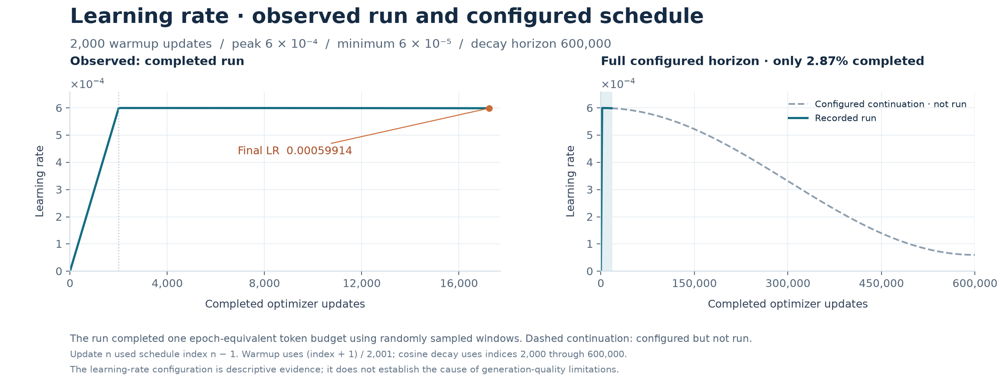

# GPT-2 Small training guide

This guide describes the completed **124M OpenWebText experiment** in `gpt2/`. The earlier untied-embedding 163M experiment is documented separately in [legacy-training.md](legacy-training.md).

## Environment

The completed run used Linux, Python 3.13.11, PyTorch **2.10.0+cu128**, CUDA **12.8**, BF16, Flash SDPA, compiled graphs with fixed shapes, and fused AdamW. It used three machines with one GPU each: two RTX 2000 Ada Generation 16 GB cards and one RTX 5000 Ada Generation 32 GB card. A compatible CUDA driver, working NCCL connectivity, and identical source/data on all workers are required for this setup.

For that software stack:

```bash
python -m pip install torch==2.10.0 --index-url https://download.pytorch.org/whl/cu128
python -m pip install -r requirements.txt
python -m pip install -r requirements-data.txt
python gpt2/train.py --smoke-test --device cpu
```

Install the appropriate PyTorch build for other hardware. Changing the stack can change numerical results. A CPU smoke test validates logic; it is not a GPU performance measurement or full distributed validation.

## Prepare OpenWebText

```bash
python gpt2/prepare.py --check-only
python gpt2/prepare.py
python gpt2/prepare.py --verify-only
```

`--check-only` checks prerequisites and disk without downloading. Full preparation downloads the pinned `Skylion007/openwebtext` revision, encodes documents with GPT-2 BPE, appends EOT per document, and writes uint16 token binaries plus a manifest to `gpt2/data/openwebtext/`. It uses a seeded document-level train/validation split. Budget roughly 120 GiB of free space for the source, caches, tokenized output, and working files. See the source for the exact preflight rules.

| Split | Documents | Tokens |
| --- | ---: | ---: |
| Train | 8,009,762 | 9,035,582,489 |
| Validation | 4,007 | 4,434,606 |

The completed run processed 9,035,579,392 training targets, rounded to complete global batches. This is an epoch-equivalent token budget, not a nonoverlapping pass: the loader samples random contiguous windows, which can repeat or overlap. Dataset file hashes and split parameters are in [the experiment record](../configs/gpt2-small-epoch1.json). `prepare.py` supports `--data-dir` and `--cache-dir` for alternate storage. All three workers must see identical prepared bytes and manifests.

## Launch the recorded three-machine configuration

Run the following on **each machine**, with a different `NODE_RANK` of 0, 1, or 2. Replace the example address with the reachable rank-0 host and use an unused shared rendezvous port. Set up network connectivity independently; the repository does not contain private SSH configuration.

```bash
export MASTER_ADDR="rank0.example.internal"
export NODE_RANK=0  # Set to 1 or 2 on the other machines.

torchrun --nnodes=3 --nproc-per-node=1 \
  --node-rank="$NODE_RANK" \
  --master-addr="$MASTER_ADDR" --master-port=29500 \
  gpt2/train.py --micro-batch-size 8 \
  --data-dir gpt2/data/openwebtext \
  --out-dir runs/gpt2-epoch1 \
  --log-interval 1 --stop-at 17234
```

All nodes participate in the same job. The command performs a real training run; it is not needed to inspect the published results. An equivalent single-machine three-GPU topology uses `torchrun --standalone --nproc-per-node=3` with the same script options, but it does not reproduce the recorded hardware layout or timings.

The exact global batch is **524,288 tokens = 512 sequences × 1,024 tokens**. At world size 3 and microbatch capacity 8, rotating sequence quotas and partial final microbatches require 22 accumulation rounds. The trainer weights those partial batches so DDP produces the correct global token mean; `3 × 8 × 22` is not the effective sequence count.

The optimizer uses AdamW with betas `(0.9, 0.95)`, epsilon `1e-8`, weight decay `0.1` on eligible matrix parameters, and gradient clipping at norm `1.0`.

## Learning-rate schedule and stopping rule

| Setting | Value |
| --- | ---: |
| Warmup | 2,000 updates |
| Peak learning rate | 0.0006 |
| Cosine decay horizon | 600,000 updates |
| Minimum learning rate | 0.00006 |
| Actual completed run | 17,234 updates |
| Final learning rate | approximately 0.0005991 |

The source defaults to a 600,000-update training horizon. **Always pass `--stop-at 17234` to reproduce this run's one-epoch-equivalent limit.** The stop limit does not compress or reset the schedule. Resuming restores the optimizer and progress. The early stop is relevant context, but this experiment does not isolate its causal effect on model quality.



## Checkpoints and resume

`latest.pt` is atomically replaced at completed-update boundaries, normally every five minutes. Token milestones and the final checkpoint are separate files. Checkpoints retain model, optimizer, scaler, data-loader progress, and per-rank RNG state. Private recovery configurations and active-run records are intentionally excluded from publication.

To resume, put the **same trusted checkpoint** on all three machines at the path passed below, then use the same launch command with these script options:

```bash
torchrun --nnodes=3 --nproc-per-node=1 \
  --node-rank="$NODE_RANK" \
  --master-addr="$MASTER_ADDR" --master-port=29500 \
  gpt2/train.py --micro-batch-size 8 \
  --data-dir gpt2/data/openwebtext \
  --out-dir runs/gpt2-epoch1 \
  --log-interval 1 --stop-at 17234 \
  --resume runs/gpt2-epoch1/latest.pt
```

Manual resume checks enforce model/training configuration and recorded runtime/data compatibility, including world size, batch policy, precision, kernels, PyTorch, and CUDA versions. Use the same source on all workers: manual resume does not verify its hash; source-hash enforcement is part of the separate recovery supervisor. Never initialize a fresh model to stand in for a missing checkpoint. The public inference command uses an explicit checkpoint because local active-run records are not shipped.

## Training curves and data

The published CSV contains all 17,234 unique completed updates and validation observations. A duplicate log of update 5 is resolved by retaining the last occurrence; the duplicate had identical loss, LR, and token count. No optimizer steps are missing. Figure smoothing is for readability only; raw measurements remain in the CSV.

Sampled validation averages 200 batches per worker across three workers: **4,915,200 sampled target positions**, with overlap permitted. Final sampled cross-entropy was **3.1298661232**; perplexity was **22.8709174522**. The separate full-file post-training evaluation scores 4,434,605 distinct targets and uses a sliding-window protocol; it is documented in [evaluation.md](evaluation.md).

Throughput is global training targets divided by measured update time. The aggregate figure of **42,652.50 tokens/s** excludes downtime, checkpoint saves, and validation outside the timed update sections. It is not end-to-end wall-clock throughput.

To rebuild the training figures from published data, use the plotting command documented alongside [results](../results/). The original model and preparation files are retained byte-for-byte, with [source hashes](../results/source_provenance.json), so organizing this repository does not rewrite the experiment that produced the checkpoint.
